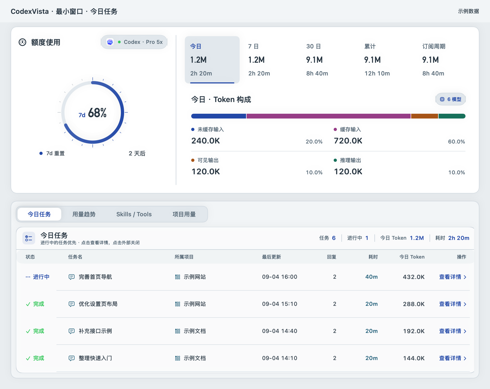
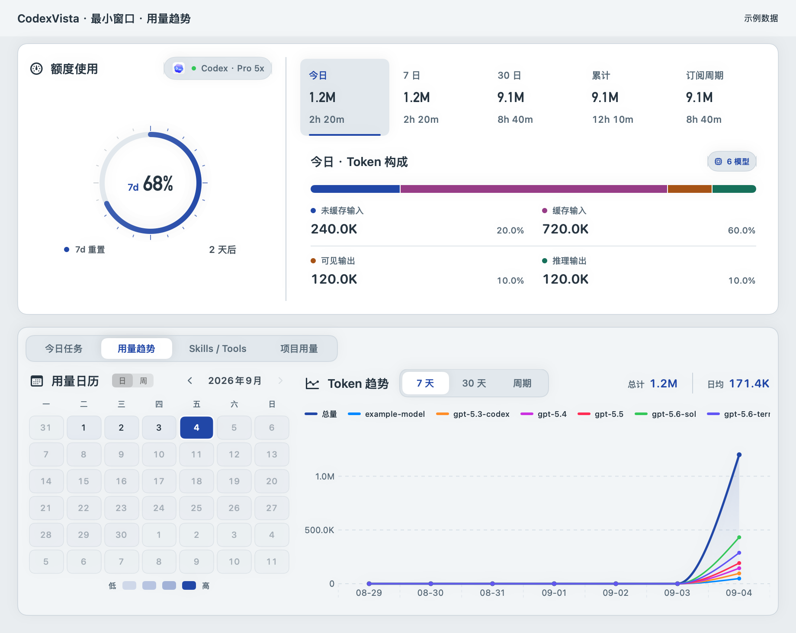
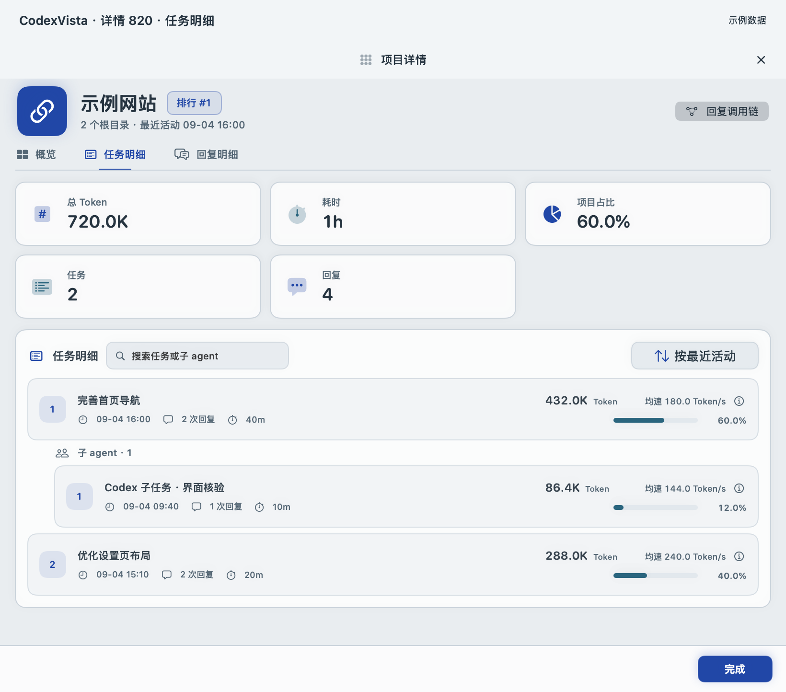
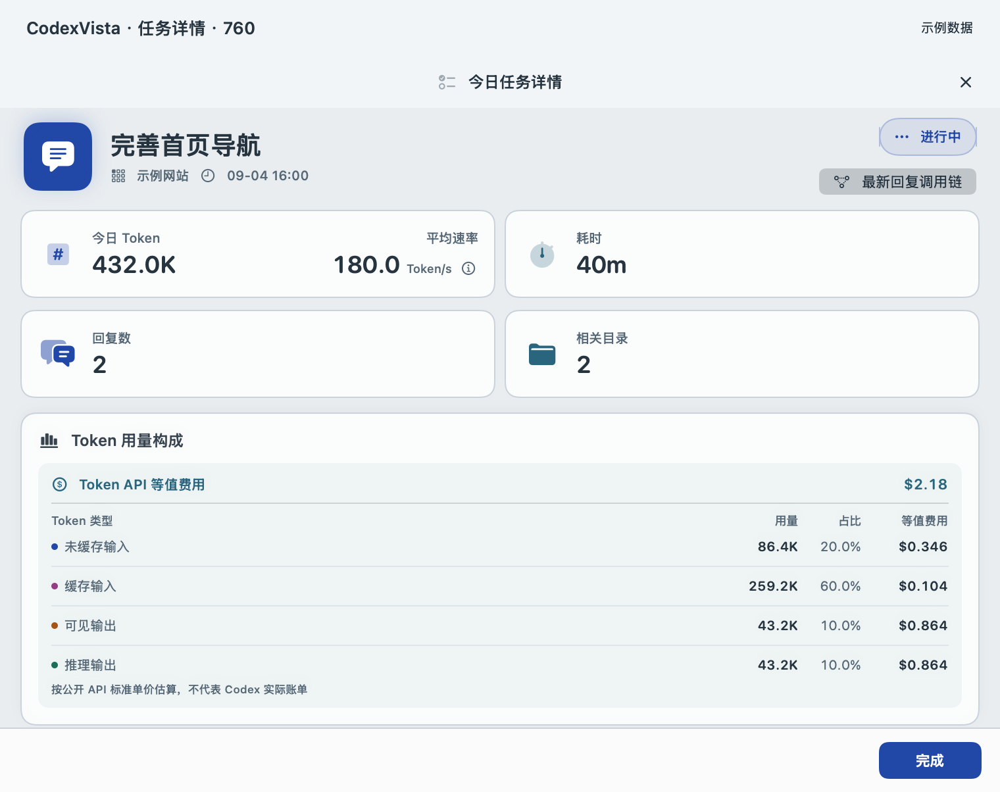
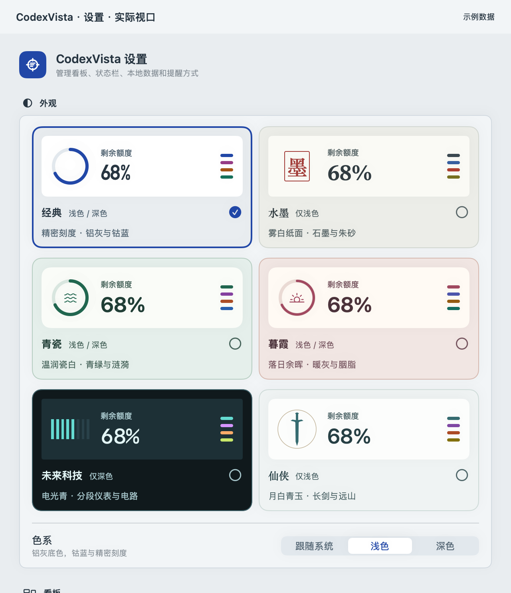

# CodexVista 逐页布局检查与优化方案

检查与实施日期：2026-10-23。状态：**逐页布局优化已实施**。下方先记录实际结果；第 1–9 节保留最初审计依据与候选方案，其中“现状”均指优化前。实际实现和验证范围以本节为准。

## 实施结果与验证范围

| 页面 | 已完成的调整 | 结果与证据 |
| --- | --- | --- |
| 主窗口与今日任务 | 按用户要求默认展开 310 pt 完整概览，可手动收起至 140 pt；去掉内容区重复边框；任务行 44 pt，名称优先伸展 | 手动收起概览后，920 × 690 pt、30 条匿名任务时首屏完整显示 **8 行**，原审计约 4 行；[收起后的最小窗口](../images/layout/main-dense.png) |
| 用量趋势 | 模型图例最多两行，超过 6 项显示全部曲线菜单；保留至少一条曲线；日历维持 300 pt | [最小趋势页面](../images/layout/main-trend.png) |
| Skills / Tools | 长名称可用两行、计数右对齐、条形放在下方；Skill 细分有可见入口并支持点击固定 | [长名称样本](../images/layout/activity-long-name.png) |
| 项目用量 | 标题摘要与筛选分两行；名称列弹性伸展，压缩辅助列 | 保留既有指标与排序；[最小项目页面](../images/layout/main-project.png) |
| 项目详情 | 固定标题与标签；五项统计仅在概览展示；回复改为两行，顶部动作改为“查看回复明细” | 760 × 560 pt 首屏完整显示 **4 条回复**；[项目回复](../images/layout/project-replies.png) |
| 今日任务详情 | 默认回复明细，用量与调用、关联目录分标签；固定上下文摘要 | 760 × 560 pt 首屏完整显示 **3 条回复**；[任务回复](../images/layout/task-回复明细.png) |
| 回复调用链 | 可缩放原生窗口；可隐藏节点详情；支持方向键选择和展开；关闭时清理加载视图 | [880 pt 宽](../images/layout/reply-trace-880.png)、[1040 pt 宽](../images/layout/reply-trace-1040.png)；原生打开、方向键选择和 Escape 返回已核验 |
| 设置 | 五类原生工具栏导航；主题 3 × 2 紧凑排列；说明换行；提醒阈值复选；默认当前套餐，全部套餐可展开 | [外观](../images/codexvista-settings-appearance.png)、[看板与摘要](../images/codexvista-settings-dashboard.png)、[提醒](../images/codexvista-settings-reminders.png)、[数据与更新](../images/codexvista-settings-data.png)、[订阅与关于](../images/codexvista-settings-plans.png) |
| 菜单弹窗 | 默认关键摘要，趋势与构成可展开；中间区域限高滚动，页头与底部操作固定 | [紧凑弹窗](../images/codexvista-popover.png) |
| 日期与价格明细 | 日期卡保留固定预览尺寸，提供完整明细窗口；模型价格说明可在窗口阅读；速率说明点击区域增至 24 pt | [每日用量阅读窗口](../images/layout/daily-reading.png) |
| 加载与空态 | 紧凑概览骨架；空态增加刷新与设置入口 | [加载](../images/codexvista-loading.png)、[空态](../images/codexvista-empty.png) |

本轮调整展示层、窗口和截图工具；统计口径、数据库和已有偏好值保持原逻辑。展开状态仅在当前视图内保存。既有模型排行、状态栏与刘海摘要继续保留原结构，已随主题截图回归。

已执行的验证：

- 85 个相关 XCTest 通过：`TokenFormatterTests` 34、`StatusItemPresentationTests` 14、`DashboardSnapshotTests` 19、`ReplyTraceTests` 9、`UsageReminderEvaluatorTests` 7、`UsageReminderControllerTests` 2。
- 使用 `./script/build_and_run.sh --verify` 构建并重启实际应用，核对启动路径来自本工作区产物。
- 使用 `python3 script/export_screenshots.py` 导出 69 张匿名截图，涵盖四个主标签、详情标签、五类设置、九组主题、长名称与密集样本；源码与图片指纹见[当前清单](../images/manifest.json)。历史审计证据保留在单独目录。
- 原生窗口核对概览展开/收起、任务默认回复页、调用链打开与方向键导航（上下选择、左右折叠展开）、Escape 返回、设置分类导航，以及价格说明阅读窗口的打开和关闭。确认框保留原生实现，未将不可靠的离屏图当作通过证据。
- 后续按用户要求将主页概览改为默认展开：5 个窗口布局相关测试通过，重新构建并重启后，原生主页显示“收起概览 / 已展开”；文档中的紧凑概览与密集任务截图明确使用手动收起状态。

尚未完整执行：多显示器与屏幕四边定位、1000 节点压力场景、VoiceOver 全程、系统提高对比度/减少动态效果，以及所有异常状态的交互矩阵。静态截图通过不代表这些场景全部通过。

---

## 1. 结论与优先级

当前主题、配色和数字样式已有一致性。最值得调整的是信息占比和浏览顺序：主窗口把大量高度留给额度与汇总；详情页把列表放在重复统计之后；设置把所有功能放在一条长滚动页面里。

建议保留四个主标签和现有皮肤，先调整共用布局，再细化单页。P1 表示优先提升日常使用效率，P2 表示后续完善；本次未发现可仅凭布局证据认定的 P0 阻断问题。

| 优先级 | 问题与证据 | 建议结果 |
| --- | --- | --- |
| P1 | 主窗口概览固定 310 pt；在 920 × 690 pt 内容区占约 45%，今日任务仅显示约 4 个完整行 | 默认紧凑概览 112–144 pt，完整额度图与 Token 构成可展开，列表获得更多高度 |
| P1 | 项目三个标签都先显示五张统计卡；任务详情在 Token、工具和目录之后才显示回复 | 列表标签改用单行摘要；任务详情默认展示回复，统计与目录放入独立标签 |
| P1 | 设置固定 640 × 700 pt，首屏几乎全部用于六张主题预览卡 | 增加五类设置导航，压缩主题选择卡，常用功能直接定位 |
| P1 | 设置说明统一单行，订阅日期等有用信息出现省略 | 说明允许两行；完整日期和必要估算说明不依赖悬浮阅读 |
| P2 | 表格、排行和详情大量使用 8.5–10.5 pt 文字、固定名称列和密集徽标 | 让名称与关键数值优先，统一桌面字号与列收缩顺序 |
| P2 | 菜单弹窗承载完整图表与构成；部分悬浮明细需要较长滚动 | 快速预览展示关键摘要，完整阅读提供可固定的入口 |
| P2 | 调用链固定 1040 × 670 pt，时间线和检查器都有较大的最小宽度 | 调整为可缩放窗口；窄宽度可收起检查器，保留明确入口 |

## 2. 检查范围与证据边界

- 使用当前工作区 SwiftUI / AppKit 组件，包括尚未提交的回复调用链入口。基础提交为 `da3123f3c297a1f7b9359feaa00229b22b092f2d`，不能将它当作实际截图的完整代码版本。
- 在隔离的文档应用中生成 67 张匿名截图，检查主要页面、窄窗口、代表主题、设置分区及二级明细；另检查调用链的匿名组件示例。保留 12 张关键证据，尺寸与 SHA-256 见[审计清单](../images/layout-audit-20261023/manifest.json)。
- 主窗口检查内容视口 920 × 690、1060 × 840 pt；项目详情检查 760 × 560、820 × 680 和宽窗口；任务详情检查 760 × 560、820 × 680 pt；设置检查 640 × 700 pt 和分区长图。
- 批量截图为 2× 像素比例，顶部另加 42 pt 文档标题，标题不属于应用界面。设置视口由当前分区组件按生产布局组合；调用链示例使用简化标题，不代表完整原生 Sheet。
- 所有示例为匿名合成数据，未为此次布局检查读取真实会话正文或认证信息。截图中的数值、日期和套餐仅用于展示布局。
- 部分窄窗口项目详情的 `LazyVGrid` 在离屏捕获中未绘制卡片。此类空白不列为产品缺陷；重复卡片和换行占高由源码及正常渲染截图共同确认。原生重建确认框的捕获结果不可用，未纳入视觉结论。
- 静态截图不能证明鼠标悬浮、键盘导航、屏幕边缘定位或缩放过程正确。相关项目在末尾列为实施后的验收项，未宣称本次已经通过。

## 3. 主窗口：先调整共用框架

### 3.1 额度与周期概览

当前 [`DashboardWindowLayout`](../../Sources/CodexVista/Features/Dashboard/DashboardView.swift) 将概览固定为 310 pt，左侧额度宽 280 pt；四个主标签都复用这一布局。视觉重心集中在额度环和 Token 构成，用户切换到任务或项目后，可浏览的数据仍然很少。



建议默认使用两行紧凑概览，目标高度 112–144 pt：

```text
额度剩余 / 重置时间 / 套餐                  展开概览
今日 · 7 日 · 30 日 · 累计 · 订阅周期        Token 构成 / 模型明细入口
────────────────────────────────────────────────────
今日任务      用量趋势      Skills / Tools      项目用量
当前页面标题 / 筛选 / 必要摘要
表头
主要列表或图表：使用剩余高度，独立滚动
```

具体调整：

1. 紧凑态保留额度百分比、重置时间、周期数值和单位；缩小额度图形，装饰放入展开态。完整概览展开后仍可保留目前约 310 pt 的表达。
2. 周期项保留 Token 与耗时的比较能力；四类 Token 构成和模型排行通过明确按钮展开。大窗口与小窗口采用同一信息顺序。
3. 概览周期与分析页时间范围各自保留清晰标签，避免布局合并后改变原有统计含义。
4. 标签导航保持可见，内容区独立滚动；去掉“分析容器 + 页面容器”之间重复的厚内边距和边框，仅保留一层主要内容边界。
5. 目标是在 920 × 690 pt 下，使用至少 10 条匿名任务时，首屏显示不少于 7 个完整任务行。先靠空间重分配实现，不靠继续缩小文字。

紧凑态比当前概览释放约 166–198 pt。保留用户手动展开的能力；如持久化展开偏好，需要同步默认值与偏好测试。

### 3.2 今日任务

**现状**：状态、任务、项目、更新时间、回复、耗时、Token、操作排列明确，进行中任务有颜色和文字双重提示。主要问题是可见行数少，以及多列小字竞争空间。

**方案**：

- 名称列优先伸展；Token、耗时和状态保持可比较。窄宽度将更新时间缩为相对时间，完整时间保留在帮助文本中；项目可作为名称的次级一行。
- 主文案建议 12–13 pt，辅助信息 11 pt，紧凑表头 10–11 pt。采用 40–48 pt 行高并验证首屏行数；不在每行重复解释“点击查看详情”。
- 行点击、末尾详情按钮与键盘确认进入同一详情；对可交互区域提供焦点和选中态。
- 新回复调用链入口继续出现在任务详情的回复列表中，顶部“最新回复”快捷入口保留。

相关实现：[TodayTaskPanel.swift](../../Sources/CodexVista/Features/Dashboard/TodayTaskPanel.swift)。

### 3.3 用量趋势

**现状**：日历固定 300 pt，右侧趋势图在最小宽度较紧。模型图例已有横向滚动和滚动条；静态首屏最后一项被截断，是否还有更多模型不够直观。这是可发现性问题，并非图例不可访问。



**方案**：

- 压缩概览后优先把高度交给图表；日历尝试 272–300 pt 弹性宽度，保持日期命中区域和星期文字完整，趋势图占剩余空间。
- 图例优先按可用宽度分成最多两行；模型更多时显示“全部模型”入口，并保留显隐勾选。若沿用横向滚动，增加边缘渐隐或明确的更多提示。
- 日期范围与聚合粒度放在图表标题附近，当前选择持续可见；展开某一天的明细不改变图表区域尺寸。
- 日历与趋势共同选中的日期保持一致；具体联动行为需在实施时检查当前状态流，不能仅凭截图假设已支持。

相关实现：[DashboardView.swift](../../Sources/CodexVista/Features/Dashboard/DashboardView.swift)、[UsageTrendChart.swift](../../Sources/CodexVista/Features/Dashboard/UsageTrendChart.swift)、[UsageCalendarPanel.swift](../../Sources/CodexVista/Features/Dashboard/UsageCalendarPanel.swift)。

### 3.4 Skills / Tools

**现状**：双列分组容易理解，稀疏数据下自然存在留白；留白本身不算缺陷。名称宽固定 118 pt，长命名空间容易省略，条形却获得较多宽度；Skill 细分主要通过悬浮显示。

**方案**：两列继续保留，但名称优先使用每列约 40% 的宽度并设合理上下限，数量右对齐，条形占剩余空间。长名称允许第二行或点击固定明细；细分入口增加可见展开标记及键盘操作。数据少时内容从顶部排列，不将行距拉大填满面板。

证据：[当前页面](../images/layout-audit-20261023/audit-main-activity.png)。实现：[ActivityRankingPanel.swift](../../Sources/CodexVista/Features/Dashboard/ActivityRankingPanel.swift)。长名称溢出属于源码推断风险，需补合成样本验证。

### 3.5 项目用量

**现状**：标题区把搜索、多个汇总、排序和显示控制排在一行；下方有九列指标。当前短名称样例可正常显示，但长项目名、多位计数和较长筛选值会使固定列布局更紧。

**方案**：标题行保留标题与摘要，第二行放搜索、排序和显示控制。默认列围绕项目、Token、占比、耗时及活动量；窄窗口把低频辅助指标收进项目详情，宽窗口再展开。项目名弹性伸展，数值列按单位和位数确定最小宽度；完整值可读取，排序状态不只靠颜色表达。

证据：[当前页面](../images/layout-audit-20261023/audit-main-project.png)。实现：[ProjectUsagePanel.swift](../../Sources/CodexVista/Features/Dashboard/ProjectUsagePanel.swift)。

## 4. 详情窗口：让回复与任务先出现

### 4.1 项目概览

**现状**：五张统计卡以最小 190 pt 的自适应网格排列，760/820 pt 宽度常形成“3 + 2”，占两行；下方才是趋势与排行。概览页展示统计合理，但第五张卡造成不均衡留白。

**方案**：保留概览的指标表达，将五项改成统一指标条或紧凑两行网格；不要为凑齐整齐卡片增加无意义指标。趋势占主要区域，排行作为后续内容。项目标题、时间范围和三个标签固定在上方，内容自行滚动。

证据：[760 pt 项目概览](../images/layout-audit-20261023/audit-project-overview-760.png)。

### 4.2 项目任务明细与回复明细

**现状**：[`ProjectDetailView`](../../Sources/CodexVista/Features/Dashboard/ProjectDetailView.swift) 在切换标签前无条件放置 `summaryCards`，两个列表标签因此重复承担约两行统计卡的高度。行右侧指标区固定 210 pt，回复还包含调用链按钮；标题和模型较长时左侧可读空间有风险。



**方案**：

- 列表标签只保留一条约 36–44 pt 的上下文摘要，如“任务数 · 回复数 · 总 Token · 总耗时”，五张大卡仅出现在概览。
- 任务行突出任务名、状态、总 Token 和耗时；agent 层级用缩进与展开控件表示，辅助统计移入第二行或明细。
- 回复行第一行展示名称、时间/状态与“查看调用链”；第二行展示模型、Token 与耗时。窄窗口右侧统计区允许收缩或下移，不与标题抢固定宽度。
- 项目顶部目前“回复调用链”快捷动作实际切换到回复列表。建议文案明确为“查看回复明细”，每条回复保留“查看调用链”，让动作结果可预期。
- 从详情进入调用链后返回，应保留标签、滚动位置和选中行。

回复页宽窗口证据：[当前回复明细](../images/layout-audit-20261023/codexvista-reply-details.png)。760 × 560 pt 验收目标：至少显示 4 条包含主要指标及调用链入口的完整回复行。

### 4.3 今日任务详情

**现状**：内容顺序是任务标题 → 统计卡 → Token 费用 → Skills / Tools → 目录 → 回复。在 760 × 560 pt 首屏中，回复列表尚未出现；用户从任务进入后，需要先浏览较多汇总。



**建议结构**：

```text
任务名 / 状态 / 所属项目                   最新回复调用链
回复数 · 总 Token · 耗时 · 更新于
回复（默认）      用量与调用      关联目录
当前标签内容独立滚动
```

“用量与调用”承载 Token 构成、API 等值费用和工具统计；关联目录继续仅展示安全目录名称，避免暗示目录级 Token 分摊。默认回复标签应在首屏直接提供至少 3 条回复及调用链入口。共用项目详情的标题、标签、列表行和关闭交互，减少两套详情布局的差异。

### 4.4 回复调用链

**现状**：树、时间线和右侧检查器的阅读关系清楚，失败节点具有图标和颜色提示，应保留。当前完整 Sheet 固定 1040 × 670 pt，时间线最小宽 580 pt，检查器 230–300 pt；它比项目详情的最小宽度大。原生 Sheet 如何在小屏幕上安置，仍需实机验证。

**方案**：

- 改用可缩放详情窗口，初始 1040 × 670 pt、最小目标 880 × 560 pt，打开时限制在屏幕可见范围内；不足 960 pt 宽时允许收起检查器，通过明确按钮恢复。
- 名称与时间线分隔位置可调整；深层 agent 限制视觉缩进的增长，保留完整层级语义与名称帮助文本。
- 让树行支持键盘上下选择、左右展开收起；搜索、筛选、选中节点保持稳定。底部“估算时间 / 单点记录”解释可以换行，不挤压关键操作。
- 保留刷新、失败重试、空结果和完成关闭；不通过增加正文、工具参数等采集内容来填充检查器。

证据：[匿名调用链组件示例](../images/layout-audit-20261023/audit-reply-trace.png)。实现：[ReplyTraceView.swift](../../Sources/CodexVista/Features/Dashboard/ReplyTraceView.swift)。

## 5. 设置：使用可直接定位的分类

当前 [`SettingsView`](../../Sources/CodexVista/Features/Settings/SettingsView.swift) 将八个分区依次放在一个固定 640 × 700 pt 的滚动视图。六张大主题预览卡占据首屏，提醒、刷新、更新和订阅需要向下寻找；说明文字的 `lineLimit(1)` 还截断了有用信息。



建议使用原生设置工具栏或 `TabView`，保持约 640 × 700 pt 的窗口，不依赖扩大窗口解决定位问题：

| 分类 | 当前分区如何安置 | 具体调整 |
| --- | --- | --- |
| 外观 | 皮肤、色系 | 六主题改为 3 列 × 2 行紧凑卡，目标每卡高 100–120 pt；当前主题可另显示较大预览。保留选中勾、键盘焦点、支持色系说明 |
| 看板与摘要 | 看板、状态栏、刘海摘要 | 相关开关与实际预览相邻；摘要位置与倒计时设置在同组，依赖条件明确 |
| 提醒 | 额度提醒、权限状态 | 总开关在组头；20% / 10% / 5% 使用有勾选状态的多选项，避免看起来像单选分段控件；权限操作靠近状态 |
| 数据与更新 | 来源、刷新、导入状态、重建、软件更新 | 常用刷新在上，来源健康信息紧凑展示；重建放独立维护区并保留确认；更新区显示版本、状态和操作 |
| 订阅与关于 | 套餐、订阅周期、估算说明、隐私说明 | 当前套餐和周期在前，套餐目录可展开比较；完整周期日期可见，隐私和估算边界保留可访问入口 |

统一表单布局规则：标签区按内容分配，不再把所有说明固定在 205 pt、控件固定在 248 pt；短开关可横排，长说明允许两行，复杂日期与价格说明采用独立整行。对于有重要日期的行，不使用省略号隐藏核心内容。

订阅区域证据：[当前套餐与周期设置](../images/layout-audit-20261023/codexvista-settings-plans.png)。本方案只调整布局，不变更套餐、价格数据或费用计算。当前 API 等值估算与实际账单的区分应继续可见。

## 6. 菜单栏、刘海与二级明细

### 6.1 菜单栏用量弹窗

**现状**：390 pt 宽的弹窗同时放置额度、120 pt 高趋势、Token 构成、更新状态和底部操作，信息完整但偏长；根视图没有整页滚动容器。

**方案**：默认目标高度约 420–480 pt，首屏优先额度/重置、今日用量和最近回复速率；趋势、Token 构成通过展开显示。实际最大高度按 `visibleFrame` 限制，中间内容可滚动，底部“打开看板 / 设置 / 退出”保持可达。“已是最新版本”放到设置，仅在有更新、下载中或失败时突出更新状态。

证据：[当前弹窗](../images/layout-audit-20261023/codexvista-popover.png)。实现：[MenuBarPopoverView.swift](../../Sources/CodexVista/Features/MenuBar/MenuBarPopoverView.swift)。

### 6.2 状态栏与刘海摘要

现有额度、倒计时和主题表达紧凑，本轮没有足够依据要求重做。保留共享绘制，重点回归 0% / 100%、未知/过期额度、倒计时位数变化，以及不同刘海和屏幕安全区域。固定皮肤与明暗主题的含义保持一致。

### 6.3 悬浮卡、模型排行与说明弹窗

| 页面 / 浮层 | 当前评价 | 优化方案 |
| --- | --- | --- |
| 模型前五预览、完整排行 | 排序与费用/Token 明细清楚，已有固定明细能力 | 保留结构，长模型名优先，费用与 Token 的表头、单位持续可见；延续现有点击/固定入口 |
| 模型 Token / 费用明细 | 四类构成和估算说明已明确 | 统一数值右对齐和名称字号；完整值可读；不要删掉近似价格标识 |
| 模型价格目录 | 表格之外还有较多解释，阅读负担较大 | 预览保留关键口径，完整目录和解释通过可固定窗口阅读；说明可折叠但保留入口 |
| 趋势日期卡、展开模型明细 | 308 × 400 pt 固定卡内可以滚动，展开多模型时浏览较长 | 预览突出日期、总量、构成及必要估算，增加“查看完整明细”；保留固定尺寸，避免恢复内容驱动的原生弹窗动态缩放 |
| 日历日期卡、图例、项目趋势节点 | 适合轻量预览 | 统一摘要字段顺序和点击固定交互；验证靠近屏幕边缘时的位置，不凭独立卡截图判断定位 |
| 任务/回复调用明细 | Token、费用、Skill/Tool 内容较长，已有窗口限高与部分列表滚动 | 预览只放 4–6 项关键摘要，长列表进入固定明细；调用链按钮保持明确 |
| Skill 命名空间细分 | 少量子项清楚，依赖悬浮的发现性有限 | 增加可见展开标记，点击与键盘可打开相同内容 |
| Token 速率说明 | 16 pt 图标作为点击入口，说明宽约 300 pt | 保留图形尺寸，增加至约 22–24 pt 的桌面点击区域和明确辅助功能名称 |

实现参考：[DailyUsageHoverCard.swift](../../Sources/CodexVista/Features/Dashboard/DailyUsageHoverCard.swift)、[ModelUsagePanel.swift](../../Sources/CodexVista/Features/Dashboard/ModelUsagePanel.swift)、[ProjectConversationHoverCard.swift](../../Sources/CodexVista/Features/Dashboard/ProjectConversationHoverCard.swift)、[TokenRateInfoButton.swift](../../Sources/CodexVista/Features/Shared/TokenRateInfoButton.swift)。日期卡固定尺寸有规避 AppKit 布局问题的明确代码注释，调整内容时应保留这一约束。

## 7. 加载、空数据、错误与统一样式

| 状态 / 规则 | 优化要求 |
| --- | --- |
| 加载骨架 | 当前骨架的卡片结构与现有周期/构成布局已有差异；按优化后的概览和列表重画，加载完成尽量不产生大幅位移 |
| 空数据 | 正文保留原因说明，并提供刷新、查看数据来源等相关动作；区分“没有数据”和“筛选没有结果” |
| 失败、过期、不兼容 | 保留具体状态与恢复动作；刷新失败时如有旧数据，显示更新时间及错误状态，不冒充成功刷新 |
| 重建确认 | 保留原生确认与取消；本次没有可用的原生视觉证据，需要实机验证焦点、按钮与文案 |
| 字号 | 桌面主内容目标 12–13 pt，辅助说明约 11 pt，表头约 10–11 pt；8–9 pt 不承载必须读取的主要信息 |
| 间距与边界 | 统一 8 / 12 / 16 / 20 pt 间距节奏；窗口和内容各有清晰边界，避免重复卡片套卡片 |
| 表格与数字 | 文本左对齐、数值右对齐；等宽数字减少刷新跳动；长标题有完整读取路径 |
| 主题与辅助功能 | 保留九组配色及装饰风格；颜色之外保留文字/图标状态。对比度、提高对比度、减少动态效果需实施后实际检查 |

## 8. 实施顺序与涉及文件

以下是建议拆分的独立改动批次；工作量为相对复杂度，不是工期承诺。

| 批次 | 范围 | 主要文件 | 复杂度 | 完成标准 |
| --- | --- | --- | --- | --- |
| 1 / P1 | 主窗口紧凑概览、内容区高度、共享边距 | `DashboardView.swift`、设计系统、骨架与窗口尺寸相关测试 | 中 | 920 × 690 首屏至少 7 个任务行，四个标签均不遮挡操作，概览可展开 |
| 2 / P1 | 项目与任务详情的信息顺序、摘要、回复列表 | `ProjectDetailView.swift`、`TodayTaskPanel.swift`、`ProjectDetailWindowController.swift` | 中 | 最小详情首屏直接看到任务/回复；调用链进入与返回状态正确 |
| 3 / P1 | 设置分类、紧凑主题卡、可换行说明 | `SettingsView.swift` | 中 | 五个分类直接访问，日期/说明完整，控件不互相挤压，既有设置值不丢失 |
| 4 / P2 | 四主页面的列宽、图例、长名称、字号 | `UsageTrendChart.swift`、`ActivityRankingPanel.swift`、`ProjectUsagePanel.swift`、`TodayTaskPanel.swift` | 中 | 长内容样本与多模型样本可读，选择/排序/筛选行为不退化 |
| 5 / P2 | 弹窗摘要、固定明细、调用链可缩放与检查器 | `MenuBarPopoverView.swift`、各明细组件、`ReplyTraceView.swift`、窗口控制器 | 中至大 | 小屏可关闭、可滚动、可访问全部操作，键盘可完成主要路径 |
| 6 | 主题、状态、尺寸和文档回归 | 截图脚本、匿名 fixture、布局测试、相关文档 | 中 | 下面的验收矩阵完成，并以新组件截图更新文档 |

先完成前三批即可取得主要收益。字段取舍、字号和弹窗策略再以调整后的实际可用空间验证，避免在旧布局上逐个堆补丁。

## 9. 验收矩阵

以下保留原始完整验收目标，实际通过的项目及未覆盖范围已在文首列明；不能将此矩阵整体视为通过记录。

| 维度 | 必测样本 | 通过条件 |
| --- | --- | --- |
| 主窗口 | 920 × 690、1060 × 840；四个标签；概览展开/收起 | 无控件遮挡或必须文字被压没；任务列表满足目标行数；窗口放大后空间用于内容 |
| 项目 / 任务详情 | 760 × 560、820 × 680；概览、任务、回复、用量、目录 | 标题与标签可见，列表可滚动，回复入口首屏可达，关闭后焦点返回来源 |
| 调用链 | 880 × 560、1040 × 670；1280 × 800 / 1440 × 900 屏幕可见区域 | 检查器可收起，时间线可操作，刷新/关闭可见，不超出可见屏幕 |
| 设置 | 640 × 700；五分类；全部设置状态 | 长说明和完整日期可读，无不必要水平滚动；键盘到达每个控件 |
| 数据密度 | 0 / 1 / 6 / 30 条任务；1 / 6 / 12 个模型；长项目名、80 字符工具名 | 不因短样本恰好能容纳而漏测；空态有明确动作，长名可完整查看 |
| 调用链密度 | 0 / 10 / 1000 节点；5 层以上 agent；失败与单点记录 | 展开、筛选、选择不丢状态，长列表可浏览，估算和未知耗时仍可区分 |
| 主题 | 经典浅/深、水墨、青瓷浅/深、暮霞浅/深、未来科技、仙侠 | 主要信息可读，状态不只靠颜色；紧凑概览不会破坏主题表达 |
| 系统辅助功能 | 键盘全程、VoiceOver、提高对比度、减少动态效果 | 焦点顺序符合阅读顺序，选中/展开状态可读，主要入口无需鼠标悬浮 |
| 加载与错误 | 初次加载、空数据、旧数据刷新失败、额度过期、调用链失败重试 | 状态明确，关键操作不跳动，恢复动作可达 |
| 原生弹窗 | 屏幕四边悬浮、固定明细、菜单弹窗、重建确认 | 不越界、不意外关闭，滚动与焦点正确 |

页面布局实现、相关测试、原生启动验证和匿名截图已完成；完整辅助功能及多屏压力验收仍保留为后续验证范围。
